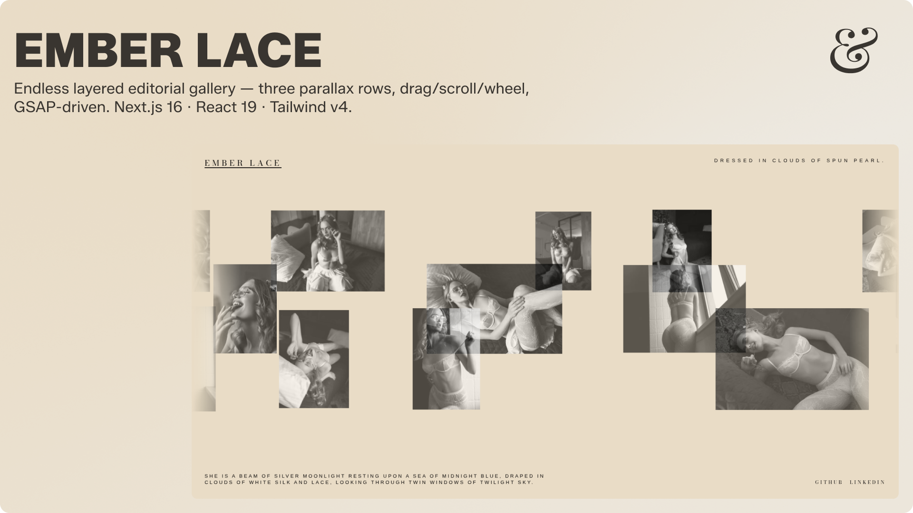

# Ember Lace ✦

A layered, endless editorial gallery. Selected looks drift across three offset rows — drag, scroll, or let the composition move on its own.

---


**Live Demo:** [](https://ember-lace.vercel.app)

---

## Features ✨

- **Three parallax rows** (`back`, `mid`, `front`) at different heights, opacities and speeds, drifting in alternating directions.
- **Infinite loop** — each row renders four copies of its slot sequence; the animation wraps by the measured distance between copies, so motion never visibly resets.
- **Pointer drag + wheel** — dragging moves every row at once with per-row drag weight, releasing flings the layers with decaying momentum. Wheel input (including trackpad horizontal swipes) feeds the same velocity.
- **Idle auto-drift** — automatic motion fades back in ~0.7s after the last interaction.
- **Reduced motion aware** — `prefers-reduced-motion: reduce` disables auto-drift, drag inertia and the intro animation.
- **Deterministic layout** — per-image heights/opacities come from a seeded hash, so server and client render identically.
- **Edge fade** — rows fade out at the viewport edges via CSS masks.
- **Layered composition** — all three rows share the same centered stage with per-row vertical offsets and z-index, so the front row reads most prominently and the mid/back rows peek through.
- **Editorial spacing rhythm** — `withRhythm()` guarantees a base gap after every image and layers extra major gaps on top, producing the uneven, magazine-like breathing between looks.

---

## Tech Stack 🛠️

| Area      | Choice                                                     |
| --------- | ---------------------------------------------------------- |
| Framework | Next.js 16 (App Router, Turbopack, React Compiler enabled) |
| UI        | React 19, Tailwind CSS v4 (`@tailwindcss/turbopack`)       |
| Animation | GSAP (`gsap.ticker` + `gsap.set`, no plugins)              |
| Fonts     | Bodoni Moda (`--font-display`), Manrope (`--font-sans`)    |
| Quality   | Biome (lint, format, import sorting), TypeScript (strict)  |
| Package   | Bun                                                        |

---

## Architecture & Design Patterns 🏗️

```plaintext
public/images/           21 gallery photos (webp)
src/
  app/
    layout.tsx           Root layout, fonts, SEO/OpenGraph metadata
    page.tsx             Renders <ImageGallery />
    globals.css          Tailwind entry, theme tokens, edge utilities
  assets/images.ts       Static imports of every image
  components/
    image-gallery.tsx    Client shell: GSAP loop, drag/wheel input, layout
    back-row.tsx         Back layer config + markup
    mid-row.tsx          Middle layer config + markup
    front-row.tsx        Front layer config + markup
  constants/gallery.ts   Slot builders, seeded randomness, shared styles
  types/gallery.ts       Slot + row configuration types
```

### Key Engineering Decisions

1. **Slot Sequence as the Row Primitive**
   Each row is a `RowConfig`: an ordered list of `Slot`s (image or gap), a direction (`1` / `-1`), speed, drag weight and height class. Rows share one markup pattern: a masked wrapper containing a grid track of `COPIES × slots`. This keeps the row component files tiny and identical in shape — only the config differs.

2. **Rhythm-Based Spacing, Not Uniform Gaps**
   `withRhythm()` places a base gap after every image and adds `rhythm[i]` extra major gaps, which gives the rows their uneven editorial spacing:

   ```ts
   slots: withRhythm(
     imageSlots([3, 1, 4, 11, 9, 5, 6], {
       minH: 90, maxH: 98,
       minO: 0.6, maxO: 0.8,
       seed: 3,
     }),
     [1, 0, 0, 1, 0, 1, 0],
     BASE_GAP,
     MAJOR_GAP,
   ),
   ```

   Because the rhythm array lives in the config, the visual cadence of each row is tunable without touching markup.

3. **Loop Period Measured From the DOM**
   `ImageGallery` measures the offset between the first slot of two consecutive copies to get the loop period, then advances every layer's `x` each tick from three sources: auto-drift, drag inertia and wheel velocity. No hard-coded widths — the loop survives font loading, image load, and viewport resize because the period is remeasured on every `ResizeObserver` tick.

4. **Deterministic Per-Image Variation**
   Per-image heights and opacities come from `hash01(seed + i)`, a sine-hash that produces stable values in `[0, 1)`. Server and client render identically (no hydration mismatch), and the "random" collage is reproducible across reloads and deployments.

5. **One Engine, Three Layers**
   The GSAP ticker, pointer handlers, wheel handler and `ResizeObserver` are all attached once to the `<section>` shell. Rows don't own any animation state of their own — they just receive a translated `x`. This means layering, z-index changes, and adding a fourth row are all trivial: assign a new `Layer`, register refs, done.

6. **Reduced Motion as a First-Class Path**
   `prefers-reduced-motion: reduce` turns off auto-drift, drag inertia, and the intro animation. The gallery becomes a static, scrollable layout with the same visual composition — no separate markup tree, no branching components.

7. **The Layer Order Contract**
   The layer order in the `useEffect` (`MID_ROW, FRONT_ROW, BACK_ROW`) matches the ref indices assigned in JSX (`rowRefs.current[0..2]`). Reordering the JSX without updating the config array (or vice versa) will silently mis-wire the layers — keep them in sync if you ever reorder.

---

## Getting Started 🏁

### Prerequisites

-  — `v20.0.0` or higher
-  — Package manager and script runner

### Installation

1. **Clone the repository**

   ```bash
   git clone https://github.com/rudra-xi/ember-lace.git
   cd ember-lace
   ```

2. **Install dependencies**

   ```bash
   bun install
   ```

3. **Run the development server**

   ```bash
   bun dev
   ```

   Open [http://localhost:3000](http://localhost:3000).

4. **Production build**

   ```bash
   bun build
   bun start
   ```

---

## Scripts & Commands 📜

| Command         | Description                      |
| --------------- | -------------------------------- |
| `bun dev`       | Start the dev server (Turbopack) |
| `bun build`     | Production build                 |
| `bun start`     | Serve the production build       |
| `bun lint`      | Biome check on `./src`           |
| `bun format`    | Format `./src` with Biome        |
| `bun check:fix` | Biome check with autofixes       |

---

## How It Works ⚙️

Each row is a `RowConfig`: an ordered list of `Slot`s (image or gap), a direction (`1` / `-1`), speed, drag weight and height class. Rows share one markup pattern: a masked wrapper containing a grid track of `COPIES × slots`.

`ImageGallery` measures the offset between the first slot of two consecutive copies to get the loop period, then advances every layer's `x` each tick from three sources: auto-drift, drag inertia and wheel velocity. The layer order in the effect (`MID_ROW, FRONT_ROW, BACK_ROW`) matches the ref indices assigned in JSX — keep them in sync if you reorder rows.

---

## Customizing 🎛️

- **Images** — drop a new file in `public/images/`, import it in `src/assets/images.ts` and add it to the `images` object. `LOOKS` picks it up automatically; reference it by index in the row configs.
- **Spacing & rhythm** — edit each row's `rhythm` array and its `BASE_GAP` / `MAJOR_GAP` clamps.
- **Motion** — tune `speed`, `drag` and `direction` per row; global easing and decay live in `image-gallery.tsx`.
- **Layering & offsets** — the center-stage composition (vertical offsets, z-index, scale) lives in the wrapper divs inside `image-gallery.tsx`. Adjust per-row `translateY` clamps to change how the three rows peek past each other.
- **Palette & type** — `--background` / `--foreground` in `globals.css`; fonts in `layout.tsx`.

---

## Accessibility ♿

- Rows are presentational beyond the first copy; duplicate images use `alt=""` and `aria-hidden`.
- The gallery is labelled via `aria-label` and is fully usable with wheel/scroll; motion is suppressed under reduced-motion preferences.

---

## Author & License 🪪

Developed by **rudra-xi**.

- [](https://github.com/rudra-xi)
- [](https://www.linkedin.com/in/goutam-rudraxi)

Distributed under the [](./LICENSE.md). Read [`LICENSE.md`](./LICENSE.md) for details.
